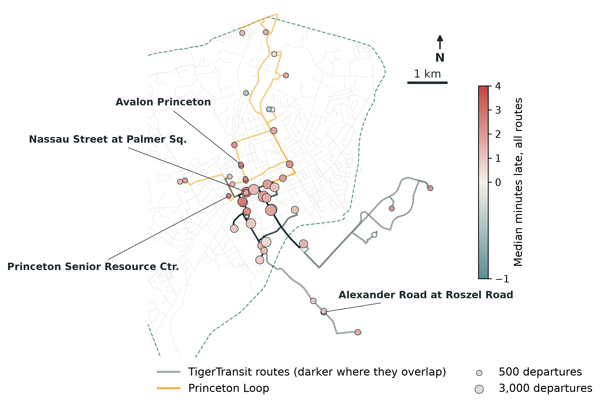
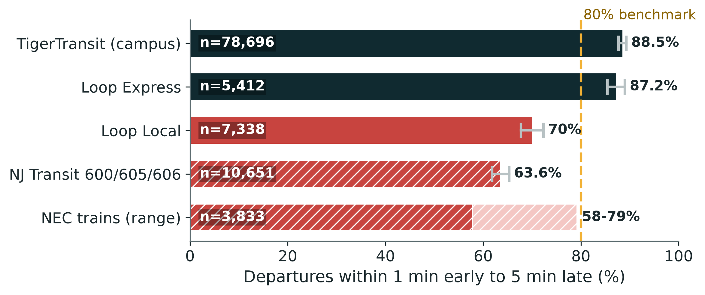
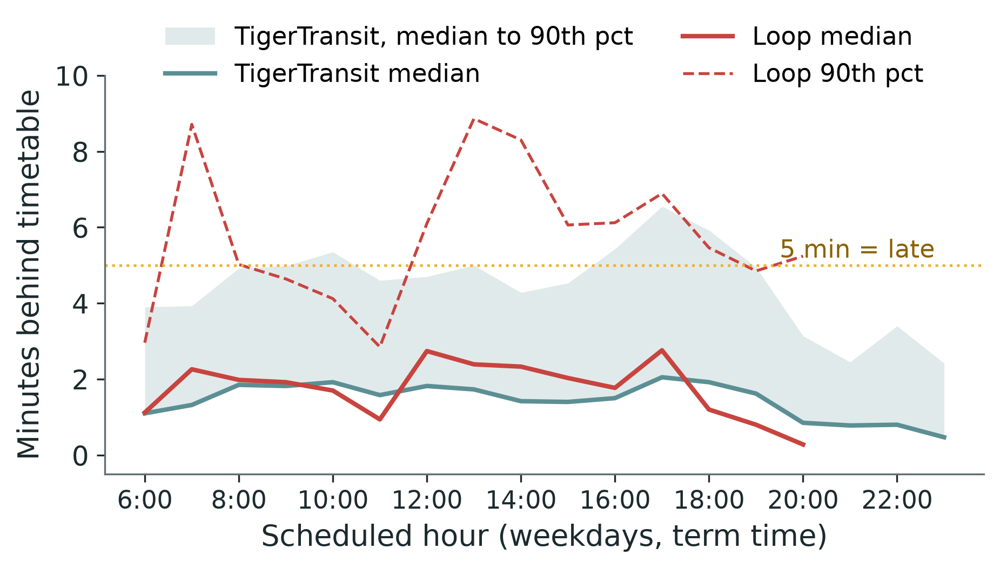
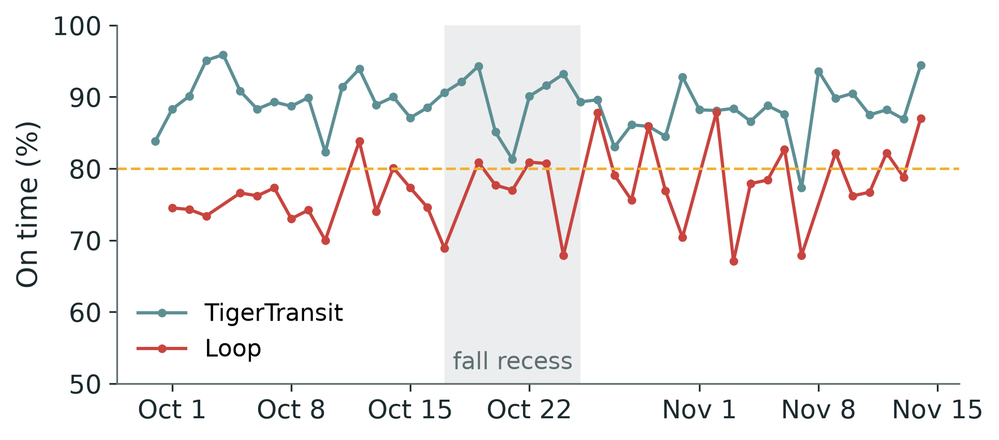
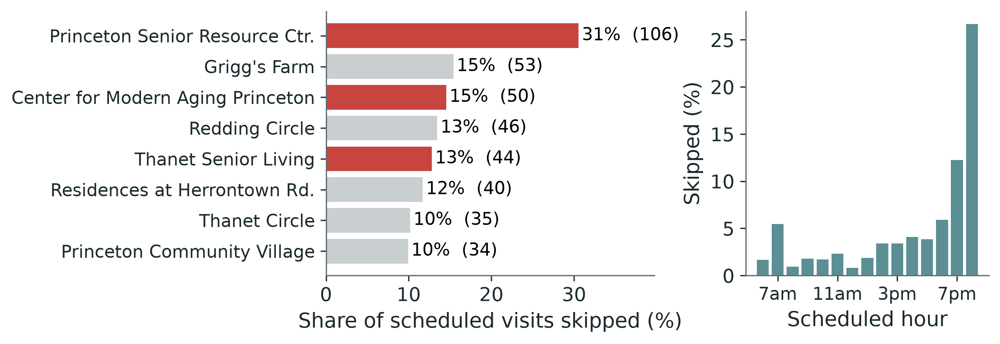
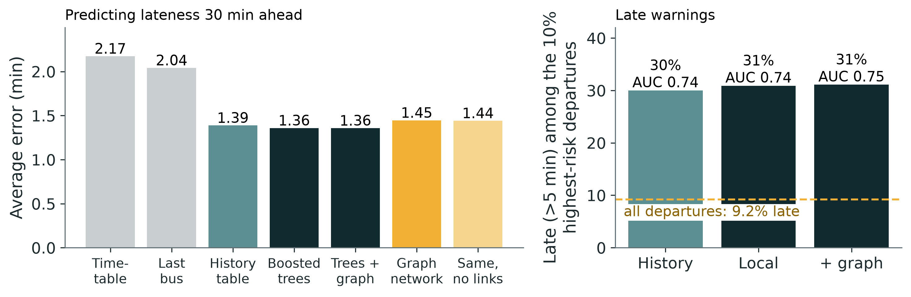
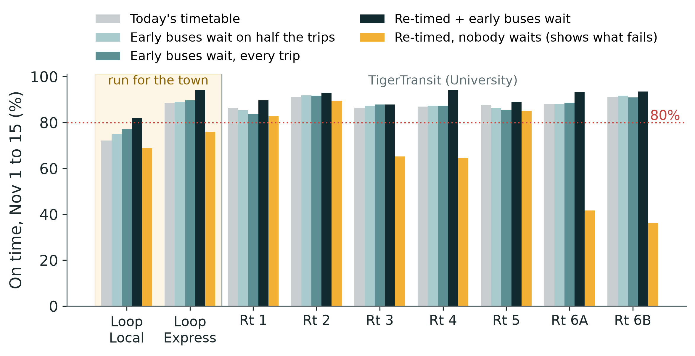
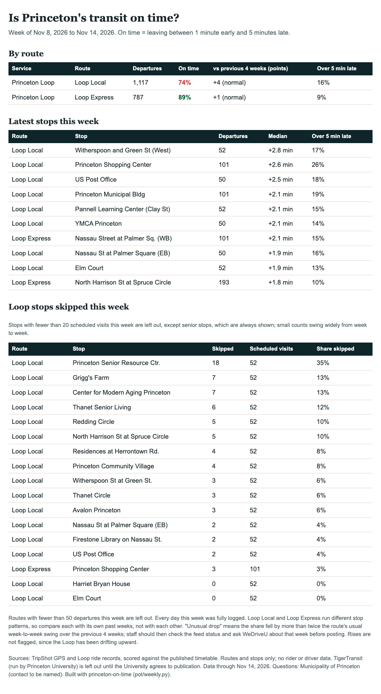

> [!summary] Summary for the Council
> - **Campus buses clear an 80% on-time benchmark; the Loop Local does not.** From September 30 to November 15, TigerTransit left 88.5% of its stops on time (1 minute early to 5 minutes late), and the Loop Express 87%. The Loop Local left 70% on time. The 80% benchmark is ours; the town has no published target.
> - **The Loop Local skips 7% of its scheduled stop visits, and one stop stands out.** The Senior Resource Center was skipped on 30.5% of visits. The other four senior stops (7.0%) are close to the rest of the route (5.8%). Separately, 8 of 355 Loop Local trips and 31 of 1,325 Express trips show no stop served at all.
> - **Lateness follows place and hour.** The same downtown blocks run late every day. In seven mild autumn weeks, we found no adverse effect of rain on either service.
> - **For the Loop Local, the cheapest fix is to have early buses wait.** Replayed on the held-out November weeks (72% on time in those weeks), waiting on every trip would lift the Loop Local to 77%, though more departures would then run over 5 minutes late (23% against 17%). Adding a re-timed schedule reaches 82%, at about 4 more minutes per afternoon trip. Both depend on drivers actually waiting: on half the trips, the gains shrink to about 75% and 77%. On TigerTransit, which already runs near 88%, waiting alone does not help.
> - **Prediction adds little.** Machine learning predicts lateness 30 minutes ahead 2% better than a simple table of past lateness. Using the route network, tested two ways, did not help.
> - **What to do first:** section 5 lists five actions with owners and costs.

# 1. No reliability figure is published for Princeton's buses

The Loop is the town's fare-free bus. The Municipality re-launched it on April 10, 2026, with a new Express route between the Shopping Center, downtown and Princeton Station (Municipality of Princeton). With TigerTransit, NJ Transit's 600, 605 and 606, the Dinky and Northeast Corridor trains, it is how residents without a car reach groceries, doctors and trains.

The operators may track punctuality internally, but no reliability figure for Princeton is published. Riders decide by feel. Yet every one of these services already publishes live data: each bus reports its position every few seconds, and every station board is public.

This project asks four questions:

- **How late?** Which bus, which stop, which hour.
- **Why?** Weather, the calendar, or the timetable itself.
- **Can it be predicted?** Thirty minutes ahead, from data a dispatcher would have.
- **What would fix it?** Without buying a bus, tested on past data before anyone is asked to adopt it.

# 2. Eight public feeds, logged every 30 seconds for 47 days

A logger on a cloud server has polled eight public feeds since September 30, 2026. It keeps vehicle positions and times only. It records nothing about riders. One operator feed also carried driver and device identifiers; the shared data have them removed, and the logger code was changed on November 15 to drop them before saving.

Exhibit: Every source is public, free and logged continuously
| Feed | Source | Every | Records |
|---|---|---|---|
| TigerTransit GPS, routes 1 to 6B | TripShot GTFS-Realtime | 30 s | 1,163,501 |
| Princeton Loop trips, stop states and GPS | TripShot route live pages | 30 s | 210,793 |
| Trains at Princeton Junction and Princeton | NJ Transit DepartureVision | 30 s | 4,200,464 |
| NJ Transit 600, 605, 606 at 7 stops | NJ Transit MyBus | 30 s | 2,263,917 |
| TigerTransit arrival predictions | TripShot TripUpdate | 5 min | 1,243,114 |
| Amtrak at Princeton Junction | Amtraker | 30 s | 124,287 |
| Weather, NWS alerts, advisories | NWS Trenton, NJ Transit, TripShot | 5 min | 13,144 |
| Stony Brook gauge and rain | USGS 01401000 | 15 min | 52,472 |
Source: project logger, Sep 30 4:04 pm to Nov 15 9:30 am, 2026; 9,271,692 records over 47 service days; no gap longer than 5 minutes in the GPS poll

Timetables change during the term. Each day is therefore scored against the timetable file (GTFS, the General Transit Feed Specification) that TripShot published that day. All 47 daily files were kept.

Exhibit: Late stops cluster downtown and on the Loop's residential stops
{width=6.2}
Source: TripShot GTFS, Nov 2026; Municipality of Princeton open data (roads, boundary). Lines: TigerTransit routes (grey) and the Loop (amber). Dots: stops with at least 100 departures, coloured by median minutes behind the timetable across all routes at that stop, blue early to red late. Exhibit 4 gives route-by-route medians, which differ slightly.

# 3. Each departure is scored the same way, every day

**Lateness** is the actual departure time minus the timetable time. **On time** means leaving between 1 minute early and 5 minutes late, the window most US agencies use (Kittelson & Associates et al.). The project scores departures, not arrivals: a bus that arrives early and waits strands nobody; a bus that leaves early does. Riders plan around the worst case, so unreliability costs them more than the average delay suggests (Furth and Muller).

- **TigerTransit.** A stop visit is the stretch of 30-second GPS fixes in which a bus names that stop as its next stop. It departs at the last fix within 40 m of the stop. For 14.8% of departures no fix fell within 40 m, and the departure is the moment the bus names the following stop. Those read 0.5 minutes later at the median (1.9 against 1.4 minutes), so they may slightly overstate lateness, though the gap could also reflect which stops lack a close fix. A trip that serves a stop twice has both visits matched in order.
- **Loop.** The operator's own ride records give, for every scheduled stop, the logged arrival and departure times and a state: Departed, Skipped or Awaiting.
- **Trains and NJ Transit buses.** These have no public position feed. Lateness is the operator's last countdown before departure, read against the timetable time. NJ Transit stops with no live bus behind the prediction are left out.
- **Last stops.** A trip's final stop is drop-off only (nobody boards), so it is not scored for TigerTransit (10,524 visits); the Loop's operator records almost never log a departure there (3 Loop Express exceptions are kept). Trips that run past midnight are scored on the day they started.
- **Filters.** A TigerTransit departure more than 5 minutes early or 60 minutes late is treated as a bus running a different trip: 385 matches, under 0.5% of all matches; another 37 visits had no timetable entry. The Weekend Shopper (2,110 departures) is a separate shopping shuttle and is left out of the TigerTransit figures.
- **Arrivals instead of departures.** Scored on arrival, TigerTransit would read 78.3% on time and the Loop 65.3%, because buses that arrive early and wait count as early. The ranking of services does not change.
- **Uncertainty.** Each on-time share carries a 95% interval from resampling whole service days, because departures on one day are not independent.

**Checks on the measurement.** Instead of field timing, the measured departures were checked against other public records:

- **GPS against the driver's log.** For the 8,525 Loop departures (67% of 12,750) where the bus's own GPS placed it within 40 m of the stop, the GPS time agrees with the logged departure within 1 minute 92.4% of the time (median difference -0.1 minutes). The other third had no fix near the stop and could not be checked, so agreement across all departures is unknown.
- **Stop-state page against the driver's log.** The 30-second poll of the stop-state page agrees with the logged time within 1 minute for 92.3% of 11,759 stops.
- **TigerTransit GPS against TripShot's published times.** TripShot's public trip-update feed republishes the actual departure time of stops a bus has already passed. For the 5,307 TigerTransit departures where it did (6.7% of all), our GPS-based departure agrees within 1 minute 98.6% of the time (median difference -0.1 minutes).

All three come through TripShot's systems, so they show the measurement is consistent across separate records, not that the operator's clock is right.

# 4. Findings

## 4.1 Campus buses clear 80%; the Loop Local and NJ Transit buses fall short

Exhibit: On-time departures by service, Sep 30 to Nov 15, 2026
{width=6}
Source: project logger and analysis. Red bars fall below an 80% benchmark chosen by the project. Hatched bars are estimated from the operator's countdown, not from GPS.

| Service | Departures | On time | 95% interval | Early | Late > 5 min |
|---|---|---|---|---|---|
| TigerTransit, routes 1 to 6B | 78,696 | 88.5% | 87.7 to 89.3 | 2.5% | 9.0% |
| Loop Express | 5,412 | 87.2% | 85.4 to 89.0 | 0.7% | 12.0% |
| Loop Local | 7,338 | 70.0% | 67.7 to 72.3 | 13.1% | 16.9% |
| NJ Transit 600, 605, 606 (estimated) | 10,651 | 63.6% | 61.8 to 65.3 | 14.5% | 22.0% |
| NEC trains, Princeton Junction (estimated) | 3,833 | 58% to 79% (range) | not computed | n/a | at least 20.8% |
Source: results/summary.json

- **TigerTransit.** Route 2 is best at 91.5%, with 6B at 91.2%; route 3 is weakest at 83.9%.
- **The Loop Local** is the least reliable of the services run in town (the Loop, run by WeDriveU for the Municipality, and TigerTransit, run for the University). It misses both ways: 13% of its departures leave more than a minute early and 17% more than five minutes late.
- **NJ Transit buses** reach Princeton mid-route, so some lateness arrives from outside the town.
- **Trains.** 70 of 3,895 scheduled Northeast Corridor departures at Princeton Junction (1.8%) were cancelled. The train figures are the weakest in this report: 42% of countdown estimates came out earlier than the timetable, which a train cannot do, so the board's countdown runs low. Counting those as on time gives 79%; counting them as missed gives 58%. The true on-time share lies between, and the late share is likely above 21%. Weekend trains ran late more than 5 minutes more often than weekday trains (26.4% against 19.2%).
- **The Dinky** lost 74 of 1,836 runs (4.0%) to cancellation.

## 4.2 Lateness concentrates downtown and at some Loop residential stops

Exhibit: The latest stops are the same every day
| Service | Stop | Departures | Median | Late > 5 min |
|---|---|---|---|---|
| TigerTransit 1 | Nassau St at Palmer Square, westbound | 1,445 | +3.3 min | 26% |
| TigerTransit 5 | Nassau St at Palmer Square, westbound | 1,146 | +3.3 min | 25% |
| TigerTransit 5 | McCosh Walk on Washington Rd, northbound | 1,138 | +3.1 min | 21% |
| Loop Local | US Post Office | 337 | +3.0 min | 26% |
| Loop Local | Princeton Senior Resource Center | 241 | +2.8 min | 20% |
| Loop Local | Avalon Princeton | 325 | +2.8 min | 25% |
Source: results/tt_stops.csv and summary.json; stops with at least 100 (TigerTransit) or 50 (Loop) departures; route-specific medians

Lateness builds along each route and is highest on the downtown blocks. Part of it is carried in from earlier stops; we did not compare segment running times, so these data do not show whether the delay comes from downtown traffic or from time spent loading riders.

## 4.3 Rain and the calendar were not linked to later buses in mild autumn weather

Exhibit: The spread of lateness widens in the afternoon, most on the Loop
{width=6}
Source: weekday departures during term, by scheduled hour. Lines are medians; the shaded band and dashed line are 90th percentiles.

- **Rain.** In the 96 hours with rain reported at Trenton, spread over 13 days, TigerTransit ran 88.4% on time, against 88.5% in dry hours. The 95% interval for the difference is -2.2 to +2.1 points; compared within the same hour of day, the difference is -0.4 points. For the Loop we found no adverse effect of rain either. Its on-time share was in fact higher in rain hours (82.0% against 76.9%; interval for the difference +3.3 to +6.8 points), and still 5.4 points higher when compared within the same hour of day, so time of day does not explain it. We did not investigate further; it should not be read as rain helping, and it may reflect fewer riders or less traffic on wet days. These were seven mild autumn weeks with no snow and no heavy storm.
- **Calendar.** During fall recess, with campus mostly empty, TigerTransit ran 89.0% on time against 88.4% in term. The Loop (Local and Express together) ran 76.4% against 77.5%.
- **Weekends.** TigerTransit does better at weekends (90.5% against 88.3%), but the Loop, Local and Express together, does worse (72.1% against 78.3%).

Exhibit: Daily on-time share swings widely, and the Loop drifted upward with no intervention
{width=6}
Source: daily on-time share, days with at least 100 TigerTransit or 50 Loop departures; the Loop line combines Local and Express

The Loop Local's daily on-time share has a standard deviation of 7.6 points, and its weekly share drifted up about 1.3 points a week (a fitted trend), 9 points between the first and last weeks, with no change in service (65.6% in the first, partial week to 74.4% in the last week, unevenly in between). A before-and-after comparison alone could mistake that drift for a trial's effect, so section 5 proposes alternating trial weeks.

## 4.4 Some Loop Local stops are skipped far more than others

The operator's records mark a scheduled stop Skipped when the bus does not serve it. Over 39 service days (the Loop does not run on Sundays, and its ride records start October 1), 614 scheduled visits were marked Skipped, 561 of them on the Loop Local. The Loop Local skipped 7.1% of its scheduled visits. Another 79 Loop Local visits were never marked either way, so the true rate lies between 7.1% and 8.0%. Eight of 355 Loop Local trips, and 31 of 1,325 Express trips, show no stop served at all.

Exhibit: A handful of stops, and the last evening runs, account for most skips
{width=6.4}
Source: TripShot ride records, Oct 1 to Nov 14, 2026. Left: share of scheduled visits skipped at the eight most-skipped stops (count in brackets); red bars serve senior housing or senior services. Right: share skipped by scheduled hour.

- **Specific stops, not one group.** Three senior stops are among the most skipped: the Senior Resource Center (30.5% of visits), the Center for Modern Aging (14.5%) and Thanet Senior Living (12.8%). Two other senior stops, Elm Court and Harriet Bryan House, were almost never skipped. Non-senior residential stops such as Grigg's Farm (15.4%) and Redding Circle (13.5%) are skipped about as often. Within the Loop Local, the five senior stops together were skipped on 11.7% of visits, twice the 5.8% of its other stops (95% interval for the gap, from resampling days: 4.8 to 7.2 points). That interval treats stops as fixed; the gap rests mostly on one stop. Leaving the Senior Resource Center out, the other four senior stops were skipped on 7.0% of visits, close to the 5.8% elsewhere; leaving out any other single senior stop changes the senior rate by under 3.5 points.
- **Not only an evening effect.** Before 7 pm, senior stops were skipped on 8.4% of visits against 3.1% for other stops.
- **Evenings.** On the Loop Local, visits scheduled at 7 pm or later were skipped 25.5% of the time (270 skipped visits), against 4.3% earlier in the day.

## 4.5 A table of past lateness predicts almost as well as machine learning

The project predicted each TigerTransit departure's lateness 30 minutes before it was due, using only data available at that moment. Models learned from September 30 to October 31 (53,854 departures) and were tested on November 1 to 15 (24,842 departures they never saw). The test set excludes the 0.5% of matches the filter in section 3 removed.

Exhibit: Boosted trees beat simple rules by a little; the route network adds nothing
{width=6.4}
Source: results/forecast.json and gnn.json. Left: average size of the prediction error, lower is better. Right: share actually more than 5 minutes late among the 10% of departures each method rated most at risk.

| Method | Average error | Late-warning score |
|---|---|---|
| Timetable (assume on time) | 2.17 min | |
| Delay of the last bus at the same stop | 2.04 min | |
| History: median for the route, stop and hour | 1.39 min | 0.74 |
| Boosted trees, local features | 1.36 min | 0.74 |
| Boosted trees, local and network features | 1.36 min | 0.75 |
| Graph network over the stop network | 1.45 min | |
| Same network with the stop links removed | 1.44 min | |
Source: results/forecast.json, gnn.json. The forecast covers TigerTransit only; the Loop has one bus per route and too few departures to train on. Average error = mean absolute error. Late-warning score = AUC, the chance that a randomly chosen late departure is rated riskier than a randomly chosen on-time one (0.5 is guessing, 1 is perfect).

- **The best model helps a little.** Boosted trees cut the error by 37% against the timetable and by 2% against the history table. The 95% interval of the gain over the history table, 0.02 to 0.04 minutes (computed for the trees with network features, which score the same), excludes zero.
- **The route network does not help, tested two ways.** Adding upstream stops' recent lateness to the trees changed the error by 0.001 minutes (95% interval -0.002 to +0.004). A graph network that passes lateness along the stop network did slightly worse than the same network with its links removed (1.445 against 1.440 minutes, three training runs each; the links added 0.001 to 0.009 minutes of error). It beat the stop and hour history (1.47) but lost to the route, stop and hour history (1.39). Appendix C gives the details.
- **Warnings work only as a short list.** Of the 10% of departures rated most at risk, 30% were more than 5 minutes late, against 9.2% overall. As a yes or no alarm at 5 minutes, the model catches only 4% of late buses.

## 4.6 On the Loop Local, having early buses wait is the robust fix; re-timing helps only with waiting

Each idea was replayed on the November test weeks, departure by departure and for all routes at once, because a bus often drives several routes in a day. The replay keeps every trip's real start and real running times and adds two effects:

- **Waiting.** A bus ahead of its timetable waits until the scheduled time, and the wait carries to its later stops. Drivers wait either on every trip or on a random half of trips (averaged over 20 random draws). The feed marks every stop as a timepoint, and the Loop's stop times are set stop by stop rather than evenly spaced, so the main replay allows waiting at every stop. Agencies usually hold at a few timepoints only; waiting at 4 evenly spaced stops per trip gives the Loop Local 75.4% on time (against 77.1%), with 5.5% still early and 19.1% over 5 minutes late. WeDriveU should confirm which stops drivers treat as timepoints.
- **Knock-on.** If waiting or a slower timetable makes a trip end later than it really did, the same bus's next trip starts later by whatever its real layover cannot absorb (layovers beyond 3 minutes absorb delay).

A re-timed schedule keeps each trip's start and sets each later stop at the time buses reached it from the first stop in October, at a chosen percentile, never earlier than the stop before. Trips with an unusual pause were left out of that fit. The percentile for each route (50th to 90th) was chosen on a validation week to maximise the on-time share, with no penalty for longer trips, so it favours more padding. The validation week was October 25 to 31 (the first day falls in fall recess), and it was used before the test weeks were scored. The replay also counts each trip's unobserved last leg, so a late finish eats into the real layover.

Exhibit: Waiting helps the Loop Local; re-timing without waiting hurts everywhere (waiting on every trip shown)
{width=6.4}
Source: results/timetable_test.csv, November 1 to 15, 2026 (held out)

| Route | Today | Early buses wait: half / every trip | Re-timed + wait: half / every trip | Re-timed, no waiting | Percentile chosen |
|---|---|---|---|---|---|
| Loop Local | 72.1% | 74.9% / 77.1% | 77.0% / 81.9% | 68.7% | 80th |
| Loop Express | 88.4% | 88.9% / 89.6% | 85.6% / 94.2% | 75.9% | 90th |
| TigerTransit 1 | 86.3% | 85.3% / 83.7% | 88.0% / 89.6% | 82.7% | 80th |
| TigerTransit 2 | 91.1% | 91.8% / 91.6% | 92.7% / 92.9% | 89.4% | 80th |
| TigerTransit 3 | 86.4% | 87.3% / 87.8% | 79.1% / 87.8% | 65.2% | 80th |
| TigerTransit 4 | 86.9% | 87.3% / 87.3% | 82.4% / 94.1% | 64.5% | 90th |
| TigerTransit 5 | 87.5% | 86.3% / 85.3% | 87.8% / 89.0% | 85.1% | 80th |
| TigerTransit 6A | 88.0% | 88.1% / 88.5% | 75.9% / 93.2% | 41.6% | 90th |
| TigerTransit 6B | 91.1% | 91.6% / 90.9% | 80.6% / 93.5% | 36.1% | 90th |
Source: results/timetable.json. The Loop Local ran 72.1% in these test weeks, against 70.0% over the whole period; each trial should be compared with the weeks just before it, not with the 70% average.

- **Waiting helps the Loop Local, not TigerTransit, and has a cost.** Waiting on every trip lifts the Loop Local by 5 points (72.1% to 77.1%; 95% interval for the gain, resampling test days, +1.7 to +8.2), but it turns early departures into later ones: the share more than 5 minutes late rises from 17.1% to 22.9%, because waits carry into later trips. Re-timing as well brings the late share back to 18.1% while reaching 81.9% on time (gain +9.9 points, interval +6.9 to +13.1). On half the trips, waiting gains about 2.8 points (74.9%; 73.9% to 76.6% across 20 draws). TigerTransit already runs near 88% and leaves early only 2.5% of the time, so waiting changes little; on routes 1 and 5 it costs 2 to 3 points, because the wait spills into the bus's next trip when layovers are short. With that knock-on switched off, waiting never lowers the on-time share, though more buses then run over 5 minutes late (Loop Local 17.1% to 20.9%). Schedule-based holding pays where trips have spare layover (Zhao et al.; Cats et al.). Headway-based holding (Daganzo) suits frequent routes; the Loop runs roughly hourly, so holding to the timetable is the right form here.
- **Re-timing needs waiting.** A re-timed schedule gives buses more time; if they do not wait, they run early and the on-time share falls on every route, sharply on routes 3, 4, 6A and 6B.
- **On the Loop Local, more padding scores better, at a price.** With waiting on every trip, re-timing the Loop Local at the 50th to 90th percentiles gives 75.7%, 78.7%, 79.9%, 81.9% and 82.8%. Each step adds minutes to every trip, so the choice is a trade the town and WeDriveU must make, not a number the data can pick.
- **The cost is a few minutes, and it comes out of layover.** The Loop Local runs 9 trips a day on one bus, each scheduled for 74 to 78 minutes depending on time of day, with 7 minutes between afternoon trips (3 in the morning). On weekday afternoons the median trip, first stop to last departure, grows from 74 to about 78 minutes at the 80th percentile; it now takes 75.5 in practice. Those 4 minutes would leave about 3 minutes of layover, the minimum the replay assumes a driver needs. Anything more means a dropped trip.

\pagebreak

# 5. Recommendations

Exhibit: Five actions, smallest first
| # | Action | Owner | When | Cost |
|---|---|---|---|---|
| 1 | Twelve-week trial: Loop drivers wait when early, alternate weeks | Contract manager, WeDriveU | March 2027 | About 30 staff hours; no vehicles |
| 2 | Re-time the Loop Local, once waiting works | Municipality, WeDriveU | Fall 2027 | 4 min per afternoon trip |
| 3 | Publish a weekly reliability page | Municipality (owner to be named) | From spring 2027 | Server under $30 a month plus 1 staff hour a week, or a contractor at $400 to $700 a month |
| 4 | Share the stop results with the University | Municipality | December 2026 | None |
| 5 | For information only: share the train estimates with NJ Transit | Municipality | December 2026 | None |
Source: findings 4.1 to 4.6. Details and measures of success are below. Staff-hour and server figures are the project's estimates.

- **1. Waiting trial.** No new vehicles; about 1.25 minutes of waiting per trip on average (at most 3). Staff time about 30 hours: 4 to set up, 2 a week to check the weekly page and compliance, 2 for the final analysis; WeDriveU briefs its drivers each switch week. Check the WeDriveU contract and any labour agreement first, since it changes a work rule; that sets the start, March 2027 at the earliest. Run 12 weeks, March to May 2027, alternating weeks of waiting and normal running in a balanced order (wait, normal, normal, wait, repeated), so the Loop's drift (9 points over these seven weeks) falls nearly equally on both; analyse it with a time trend. Compliance check each week: the share of waiting-week trips with any early departure. If drivers cannot keep the weekly switch straight, use two-week blocks instead. Main success test: departures more than a minute early fall from about 11% (the November test weeks; 13% over the whole period) to about 5% or less in waiting weeks (about 5.5% is what waiting at only 4 timepoints per trip leaves); 12 weeks can detect that. Secondary checks: the share over 5 minutes late stays at or below 23%, and on-time share is higher in waiting weeks, though 12 weeks can reliably detect only a 5-point on-time gain (Appendix D). Stop if trips overrun their layovers. Waiting adds about 1.25 minutes per trip on average (at most 3) for riders already on board.
- **2. Re-timing.** About 4 minutes per weekday afternoon trip. Layover is driver recovery time, so this needs WeDriveU's agreement; dropping a trip instead is a service cut that needs public notice. Judge it like action 1, in alternating weeks: re-timed weeks against waiting-only weeks. Success: on-time share about 5 points higher in re-timed weeks (the replay gives 77% to 82% with full waiting), with no dropped trips.
- **3. Weekly page.** A small cloud server, under $30 a month, and about 1 staff hour a week; the project hands over the code and a sample page. Publish weekly totals by route and stop only, never by day, hour or driver. Because each Loop route runs one bus, a week's route total can still describe one driver's shifts if one person drives it all week; WeDriveU and a labour review should agree the page before it is posted. Success: posted weekly for one term.
- **4 and 5. Sharing.** No cost. TigerTransit and NJ Transit schedules are not the town's to set; these only share data. The train figures are a wide range (58% to 79%), so they are for information, not a basis for any request. Success: Nassau Street timing reviewed by the University.

**A note for WeDriveU.** These results describe the timetable and the service, not driver conduct.

**Contract and data.** We have not seen the WeDriveU contract and do not know whether it sets an on-time standard. If these figures are ever tied to the contract, note that the Loop numbers come from the operator's own device log, so they should be checked each term against the public-record cross-checks in section 3. The feeds are public web pages and feeds published by TripShot and NJ Transit; before the town republishes figures built on them, a short data agreement with TripShot is advisable.

The weekly page already exists; Appendix E shows the version for November 8 to 14.

# 6. What this report cannot show

- **No field timing.** The departure times were checked against other public records (section 3), all from TripShot's systems, not against an independent clock.
- **Trains and NJ Transit buses are estimates.** Their lateness is the operator's last countdown, not an observed departure. The train countdown runs low, so train lateness is understated. The Dinky's board clears at departure, so only its cancellations are measured.
- **GPS departures are approximate.** TigerTransit departures come from 30-second fixes. For the 14.8% with no fix within 40 m, departure is when the bus names the next stop, which overstates lateness by about half a minute.
- **Riders are not counted.** The Loop feed reports a rider count per trip (a peak of 6 riders on a typical Loop Local trip, 2 on the Express), but what it counts is undocumented. A late bus with no riders matters less than one with ten; this report weighs them the same.
- **The fixes are a replay, not a trial.** The replay assumes traffic would not change. Results swing with how often drivers actually wait; only a trial can settle them.
- **Some Loop visits are unmarked.** 79 Loop Local visits were never marked served or skipped, and 39 Loop trips show no stop served. They are counted separately, not as late or skipped.
- **Seven weeks of autumn.** No snow, little rain, one recess. Winter may differ.

# 7. Implications for riders, privacy and fairness

**Stakeholders.** Riders gain a published standard. The Council gains a number to manage the Loop contract with. WeDriveU and the University's Transportation and Parking Services gain a stop-level list of where their timetables are too tight. NJ Transit gains a station-level view of Princeton it does not publish itself.

**Privacy.** The project logs vehicles, not people. One raw operator feed carried driver and device identifiers throughout the study period. The analysis never reads them, and the shipped sample data has them removed. Every raw Loop file in the study log, through its last poll on November 15, still contains them. The logger code now drops them before saving (tested), and the updated logger has run on the server since the evening of November 15; its newest files carry no identifiers. A public reliability page should report routes and stops, never drivers; per-driver figures would turn a service measure into staff surveillance. This report shows lateness and skips by hour, pooled over seven weeks, which cannot be tied to a shift; a weekly page by hour could be, so the page shows weekly totals only.

**Fairness.** Averages hide who bears the problem. The five senior-housing and senior-service stops the Loop serves are all on the Loop Local, the least reliable bus run in town, and the most-skipped stop on the route is the Senior Resource Center. Census estimates for one tract point the same way. The tract holding the Senior Resource Center and Elm Court is 37.7% aged 65 or over (90% margin of error ±6.5 points), against 13.0% (±1.1) for Princeton as a whole. Its share of households without a car, 27.7%, is too uncertain to lean on (±17.7, against 11.9% ±2.8 town-wide) (American Community Survey 2020 to 2024). The tract with Thanet Senior Living and the Center for Modern Aging is close to the town average (14.1% aged 65 or over, 4.1% without a car). We did not survey who rides, so we cannot say how many riders are older. Any reliability standard should be reported per stop, not only per route: a route can meet its target while particular stops do not.

**Risk of misuse.** Low rider counts on the Loop Express could be read as a case for cutting service. The count is unverified, and the Express has run for only seven months. These data support fixing the timetable, not cutting the route.

\pagebreak

# Appendix A. Reproducing every number

The repository `princeton-on-time` contains the code, a three-day sample of the data (Nov 11 to 13 log files, which touch four service days), tests, and the summary results behind every figure and table. The per-departure tables are regenerated by the run but not shipped, because each Loop route runs one bus and departure times by route could reveal a driver's shift. The public repository is a fresh copy of the team's working repository, without the earlier commits that held those tables. The code is public at github.com/skylerlchan/princeton-on-time (contact: Skyler Chan, sc8742@princeton.edu); this report was built from the version tagged `final-report`.

| Step | Command or file | Output |
|---|---|---|
| Install | `pip install -r requirements.txt` (Python 3.12); `requirements-optional.txt` adds the map, the graph network and the logger | |
| Run on the sample | `python run_all.py` | results_sample/ and figures_sample/ in about a minute |
| Run on the full log | `POT_DATA=/path/to/data python run_all.py` | every number in this report, in about 7 minutes |
| Test | `python -m pytest -q` | on-time rule, distances, the forecast's time window, the replay reproduces observed days, sample run |
| Measure | `pot/measure.py` | departures, Loop visits and skips, trains, NJ Transit buses, weather |
| Summarize and check | `pot/summarize.py`, `pot/validate.py` | summary.json, validation.json |
| Forecast | `pot/forecast.py`, `pot/gnn.py` | forecast.json, gnn.json |
| Timetable replay | `pot/timetable.py` | timetable_test.csv, timetable.json |
| Figures, weekly page | `pot/figures.py`, `pot/map.py`, `pot/weekly.py` | figures 1 to 7, weekly.html |
| Logger | `logger/logger.py` | daily files, one per feed |
Source: repository README and DATA.md

The full 2.3 GB log stays with the team because its Loop files through November 15 contain driver identifiers. Only a copy with those fields removed (the same scrub as the sample data) will be shared, on request; the town should never receive the unscrubbed files, which could otherwise become public records. The team will scrub its own copy of those files once grading ends in December 2026.

# Appendix B. AI note

We used Claude Code (Anthropic's Claude) throughout. It found and tested the feeds, wrote the logger and the analysis code, ran the analysis, drew the figures, and drafted this report from our outline. We chose the problem, the services, the on-time rule and the train and test split, and we decided which results to report, including the ones that did not work.

Eight rounds of independent review of earlier drafts found real errors, and each was fixed before this version:

- The first analysis matched every day to the latest timetable, which silently dropped three quarters of TigerTransit departures.
- It scored arrivals rather than departures, and took each train's worst countdown instead of its last one.
- It counted some affordable-housing stops as senior stops and compared senior stops with the Express.
- Its timetable replay padded every stop separately, simulated one route at a time and counted knock-on lateness twice.
- It cut GPS stop visits at midnight UTC, and mixed trips seen from their first and second stops when re-timing.
- Its replay ended each Loop trip at the last stop with a departure, missing the final leg, and mixed different stop patterns of one route when re-timing. Fixing both lowered the Loop Local waiting result from 79% to 77%.
- It scored each TigerTransit trip's last stop, where nobody boards, as a departure. Removing those raised TigerTransit from 85.7% to 88.5% on time and removed most of the apparent gain from waiting on TigerTransit.
- It reported waiting on half the trips from one random draw; the report now averages 20.

The full pipeline was then rerun from raw data. Its tests check the rules every number depends on, and one test checks that every headline number in this report matches the results files. We read every figure and table against those files ourselves before submission.

# Appendix C. Forecast details

- **Setup.** Issue time is 30 minutes before each scheduled departure. Every feature uses only departures logged before that moment. History tables for training rows are built out of fold (five folds by day), so no row sees its own day.
- **Network features in the trees.** Recent lateness at the stops one and two steps upstream, and its gap from their usual lateness. Adding them changed the error by 0.001 minutes (95% interval -0.002 to +0.004) and the late-warning score by +0.002 (interval -0.003 to +0.007).
- **Graph network.** Every TigerTransit stop is a node; an edge joins stops that follow each other on any trip. Each node carries its lateness against usual over three 10-minute slots before the issue time. Two graph-convolution layers mix neighbours, a GRU reads the three slots, and the output corrects the stop and hour history. It also sees the trip's own latest delay. The ablation is identical except that each stop is linked only to itself. Three training runs each: 1.445 against 1.440 minutes. The links added 0.005 minutes of error (95% interval 0.001 to 0.009): they made it slightly worse.
- **Why the network may not help.** Not tested: Princeton's routes are short, so a bus's lateness comes mostly from its own trip.

# Appendix D. Trial power

The detectable change is 2.8 standard errors of the difference between two 36-day means (two-sided 5% test, 80% power), using the observed day-to-day spread of the Loop Local: 7.6 points for on-time share, 5.9 for early departures. That gives about 5 points for on-time share and 4 points for early departures over 12 alternating weeks (36 service days in each arm). It treats days as independent; days within a week are alike, so real power is somewhat lower. A 6-week version (18 days per arm) could detect only about 7 and 5.5 points. If drivers wait on only half the trips (a gain of about 2.8 points), a 12-week trial has only about a 35% chance of detecting the on-time change, which is why early departures are the main test.

# Appendix E. Sample weekly page

Exhibit: The weekly page (Loop routes only until the University agrees to TigerTransit figures)
{width=4.6}
Source: results/weekly.html, week of November 8 to 14, 2026, generated by pot/weekly.py

# References

Cats, Oded, et al. "Holding Control Strategies: A Simulation-Based Evaluation and Guidelines for Implementation." *Transportation Research Record*, no. 2274, 2012.

Daganzo, Carlos F. "A Headway-Based Approach to Eliminate Bus Bunching: Systematic Analysis and Comparisons." *Transportation Research Part B*, vol. 43, no. 10, 2009, pp. 913-921.

Furth, Peter G., and Theo H. J. Muller. "Service Reliability and Hidden Waiting Time: Insights from Automatic Vehicle Location Data." *Transportation Research Record*, no. 1955, 2006.

Kittelson & Associates, et al. *Transit Capacity and Quality of Service Manual*. 3rd ed., TCRP Report 165, Transportation Research Board, 2013.

Municipality of Princeton. "Princeton Celebrates the Re-launch of the Loop Bus." 10 Apr. 2026, www.princetonnj.gov/m/newsflash/home/detail/737.

Municipality of Princeton. "Suzanne Patterson Building." Facilities, princetonnj.gov. Accessed Nov 15, 2026.

National Weather Service. API observations, station KTTN, api.weather.gov. Accessed Sep 30 to Nov 15, 2026.

NJ Transit. DepartureVision and MyBus, www.njtransit.com. Accessed Sep 30 to Nov 15, 2026.

TripShot. Princeton TigerTransit GTFS and GTFS-Realtime feeds and route live pages, princeton.tripshot.com. Accessed Sep 30 to Nov 15, 2026.

U.S. Census Bureau. American Community Survey 2020-2024 5-Year Estimates, tables B01001 and B08201, via Census Reporter, api.censusreporter.org. Accessed Nov 15, 2026.

U.S. Geological Survey. Site 01401000, Stony Brook at Princeton, NJ, waterdata.usgs.gov. Accessed Sep 30 to Nov 15, 2026.

Zhao, Jiamin, Maged Dessouky, and Satish Bukkapatnam. "Optimal Slack Time for Schedule-Based Transit Operations." *Transportation Science*, vol. 40, no. 4, 2006, pp. 529-539.
